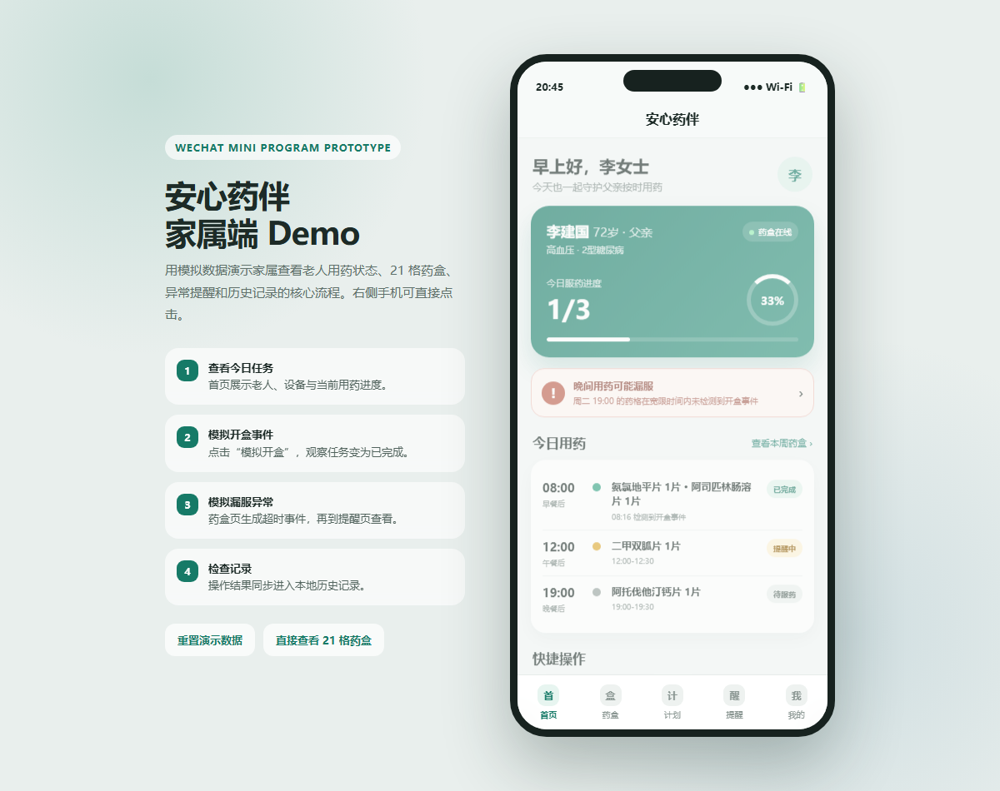

# 智慧药盒 · 家庭用药提醒原型

一个把微信小程序、浏览器演示、FastAPI 后端与 ESP32 药盒连起来的课程原型。目标是让家属设置提醒、查看药盒开盖反馈，并在超时未收到开盖记录时得到提示。**开盒不等于服药；本项目不能作为医疗确认或紧急救援系统。**



## 可以看什么

| 部分 | 已实现的内容 | 入口 |
| --- | --- | --- |
| 家属端 | 注册登录、家庭档案、用药计划增删改与启停、21 格周视图、提醒与历史 | [微信小程序](微信小程序/README.md) |
| 浏览器演示 | 与小程序共用后端的交互预览；可使用公开演示家庭体验，无需实物 | 启动后打开 `/preview` |
| 后端 | SQLite 持久化、家庭会话与数据隔离、设备独立密钥、事件去重、定时规则 | [后端说明](backend/README.md) |
| ESP32 原型 | OLED 显示、蜂鸣器提醒、一个早药格门磁、计划拉取和开盖事件上传 | [固件与验收](硬件/联调/联网药盒/README.md) |
| 延伸功能 | 药品资料录入与来源、本人同意后按同名药品话题建立站内交流 | [功能边界](项目文档/PROJECT_BRIEF.md) |

项目的重点是**区分软件模拟、设备开盖与家属确认**，并在设备断网重试时避免重复记录。实际硬件目前只有早药格接有门磁；中、晚药格不能提供真实开盖检测。微信订阅消息已有代码，但需要自己的小程序配置、模板和真机授权，手机送达尚未完成验收。

## 在本机体验

需要 Windows、Python 3.12+。在项目根目录先建立环境：

```powershell
python -m venv backend/.venv
backend/.venv/Scripts/python.exe -m pip install -r backend/requirements.txt
```

然后双击 `启动演示.bat`，浏览器访问 `http://127.0.0.1:8766/preview`，点击“先体验演示家庭”。公开演示账号是 `13800000000` / `Demo12345`，只适合测试，**不要填入真实患者信息**。首次运行自动创建本地 SQLite 数据库，该文件不会提交到 Git。

微信开发者工具可导入 `微信小程序/`。手机与 ESP32 联调需要运行 `启动局域网联调.bat`，并把小程序连接地址和固件服务地址改成当前电脑的局域网 IP；仓库里的旧热点地址不能直接用于别人的网络。详细步骤见[小程序说明](微信小程序/README.md)和[硬件接入说明](项目文档/硬件接入说明.md)。

## 验证

在项目根目录运行：

```powershell
backend/.venv/Scripts/python.exe -m unittest discover -s 测试代码 -p 'test_*.py' -v
node 测试代码/test_miniprogram_login.cjs
node 测试代码/test_medicine_support.cjs
node 测试代码/test_plan_edit.cjs
node 测试代码/test_family_confirmation.cjs
node 测试代码/test_wechat_notifications.cjs
```

Python 测试使用临时数据库。浏览器端到端测试 `测试代码/test_support_preview.cjs` 另需 Playwright 和浏览器；自动测试不能替代微信真机、微信通知送达或实物长期运行验收。

## 范围与资料

药盒仍是模拟物体验原型，不能真正存放药品。工作人员后台、线下活动服务、原型数据与真实照护数据隔离等仍是后续计划，不能当作已交付功能。当前后端面向本地演示与联调，没有生产部署、正式 HTTPS 域名和完整的真实用户数据管理流程。

- [主方案与进度](项目文档/PROJECT_BRIEF.md)
- [系统流程](项目文档/系统流程图设计.md)
- [小程序与药盒联动](项目文档/小程序联动交付说明.md)
- [公网扫码演示代码归档](公网扫码演示/README.md)：独立快照；临时二维码和本机隧道不会随仓库自动运行
- [Git 与公开展示说明](项目文档/Git使用说明.md)

`backend/` 是当前服务端，`微信小程序/` 是当前家属端和浏览器预览，`硬件/联调/联网药盒/` 是当前固件，`测试代码/` 是回归检查。`项目文档/` 保留需求、接线与答辩资料；`公网扫码演示/` 是独立访客演示快照。
