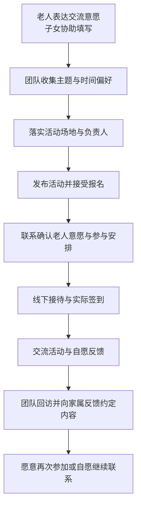

# 家庭照护支持方案

更新：2026-11-06。状态：唯一主方案；总体目标与首轮范围已确认，执行细节为建议。药品资料、储存提示及自愿同药话题交友已补充到代码；其他拟建服务不代表已经实现，硬件结构仍待实物验证。

2026-11-10 代码进度：用户确认 OLED、蜂鸣器与**早药格一个门磁**的接线已完成。已新增[联网药盒固件](../硬件/联调/联网药盒/README.md)，小程序可以修改已有用药计划时间；后端继续采用 30 分钟提醒窗口＋15 分钟宽限，并拒绝计划开始前的设备开盒事件。最新响铃为每 10 分钟连续 5 秒、截止连续 15 秒、有效开盒一声；家属手机可确认停止本次提醒，但不伪造服药记录。固件需要烧录、家庭设备编号/密钥绑定和真实开盒/微信通知验收后，才能认定业务闭环完成。以下 2026-11-06 记录保留为历史状态。

## 1. 已确认的方向

- 核心目标是帮助子女更好地照顾老人。整体成果是一套方案，药盒是其中一个组成部分。
- 现有小程序主要面向子女，暂不要求老人另学一套手机操作。
- 保留社区线下陪伴方向。2026-11-06 按新增需求补充同药话题交友：由家属协助、参与者本人自愿开启，双方接受后可在应用内文字交流，不要求老人另学一套软件。
- 工作人员是项目团队管理员，负责系统维护、申请处理和服务组织。
- 团队能够组织小型活动，负责报名、现场接待及活动后回访。
- 先邀请认识的少量老人和家属真实试用；目前没有确定活动场地，也没有确认社区合作方。
- 药盒处于未完善原型阶段，基础功能可体验，但不能真正存放药品。
- 继续取消设备心跳及实时在线/离线检测。
- 首轮优先选择同城不同住的家庭。用户倾向此场景；建议采用，便于子女核对信息和参与活动安排，同时保留对子女日常照护支持的需求。
- 第一版只做通用药支持和陪伴服务，其他照护模块纳入后续方案。
- 团队暂为 5 人；预计邀请 3 组老人和家属；最晚 2026 年 12 月中旬完成。下文按 12 月 15 日作为内部排期目标，不改变用户给出的时间范围。

## 2. 建议的总体定位

暂用描述：“面向子女的家庭照护与社区陪伴服务方案”。首轮以用药支持和线下陪伴作为两条服务主线；最终项目名未定。更广的照护需求写入后续路线，不作为本轮开发承诺。

用户价值围绕四个问题组织：

1. 子女能知道老人主动反馈了什么、最近参加了什么、有哪些待处理事项吗？
2. 需要关心时，子女能采取什么具体行动？
3. 子女暂时无法到场时，项目团队能提供哪些明确约定的支持？
4. 行动之后，谁反馈结果，什么时候算完成？

用药管理、药盒操作体验、陪伴需求与线下活动应放到这条主线中；不把设备传感器当作了解老人全部生活状态的手段。

## 3. 方案组成与职责

| 组成 | 作用 | 本轮边界 |
| --- | --- | --- |
| 子女端小程序 | 管理用药安排、药品说明书资料和储存提示；协助自愿药友交流；后续加入活动与回访 | 核心用户仍为子女；不能凭没有反馈断言老人不安全 |
| 老人的参与方式 | 当面或电话表达需求、接受/拒绝活动、提供体验反馈 | 不强制使用小程序；子女代操作仍需尊重老人意愿 |
| 团队网页后台 | 处理申请、管理活动、确认报名、签到、回访、记录处理情况 | 工作人员为项目团队；服务能力与时间需要具体约定 |
| 线下服务 | 为老人提供交流机会，组织小型活动并安排回访 | 需要落实地点、现场负责人和参加方式；目前尚未落实场地 |
| 药盒原型 | 体验提醒、开盒检测和信息传递；改进便捷取药、密封、防潮和避光结构 | 新增结构为设计与验证任务，仍只作模拟体验，不能装真实药品或替代老人日常药盒 |

首页建议从“看药盒状态”转为“今天有哪些值得关心的事情”。优先展示有时间和来源的用药反馈、待办、报名进度与回访摘要；没有数据时明确显示暂无反馈。

## 4. 自愿同药话题交友与线下陪伴

### 已补充的软件功能（2026-11-06）

新增“同药话题 · 药友”，作为原有线下陪伴方向的补充。小程序“我的”进入；浏览器预览提供同名入口。默认关闭，未开启者不会被推荐；不预置虚构药友，也不把公共演示家庭推荐给独立家庭。

流程：参与者本人同意 → 家属协助填写昵称及可选介绍 → 主动选择一项已启用的用药计划作为公开话题 → 查看同药名且同意交流的账号 → 发出邀请 → 对方接受/拒绝 → 接受后站内文字交流 → 任一方可结束关系或关闭功能。

- 推荐只使用选中的药名文字，做全半角、大小写及空白归一；不把不同药名、不同成分或相似疾病合并，不推断疾病、不建议换药。不同规格或厂家需要在计划名称中区分；匹配不代表已核实为同一制剂。
- 推荐仅返回昵称、主动填写的介绍及所选药名，不自动返回家庭姓名、联系方式、地址、病史或完整药单。用户不应在昵称、介绍、聊天中填写敏感资料。
- 本人同意单独确认，家属能登录不等于老人已同意；确认记录保存时间，但软件不能据此核验现场授权过程。
- 待接受时不能聊天；接受/拒绝只有收件人可操作，撤回只有发件人可操作；只有关系双方可访问聊天。
- 关闭功能、更换所选药名、暂停所选计划或重置家庭演示资料，会结束原有邀请和关系；双方不再能通过接口读取或发送这段聊天。重新开启需重新邀请，旧关系不自动恢复。
- 当前是基于 HTTP 的站内文字交流，展示最近 100 条消息。小程序每 8 秒刷新；浏览器在未编辑时每 8 秒刷新。不含微信好友添加、药友消息推送、语音视频或工作人员内容审核后台。
- 邀请及消息存入本地 SQLite。关闭交流不等于删除历史，旧会话保留但停止访问；数据保留、投诉处理和清除政策仍需在真实开放前完善。每账号每日最多发起 20 次邀请，每小时最多发送 60 条消息。

### 仍拟建设的线下陪伴

保留共同参加活动、帮助老人自然认识彼此的方向。活动可以围绕共同生活经历或兴趣组织，不要求参加者公开病种；下述活动后台和报名流程仍未实现。

建议服务流程：

场地和组织者落实前，只收集活动意向，不把尚未确定的活动标成可参加。首次见面后是否继续联系，由老人自行决定；未经双方接受，不自动共享电话号码或微信。

第一版可以先办一次人数有限的交流活动，之后按兴趣或共同话题形成重复见面的小组。是否使用“病友组”、活动规模和现场安排仍需结合实际参与者确定。

### 疾病与用药信息

- 不根据相似药品自动判断疾病，不自动加入某病种小组；同药话题展示与建立药友关系均需主动同意。
- 需要时让老人或家属主动填写自报病种、交流主题或兴趣；允许不填写病种。
- 自报病种不标为医疗核验结果。相似病种也不代表可以照搬药物和剂量。
- 活动报名只收集组织所需信息，不在公开名单中显示病历、药品清单、家庭地址或联系人电话。
- 老人可以通过家属或直接联系团队拒绝、取消、反馈问题；不影响其他用药功能。
- 参与意愿、信息用途与共享范围单独说明并记录；家属能登录账号不等于老人同意公开健康情况。

## 5. 工作人员端建议

先建设电脑浏览器网页后台，与小程序共用现有后端。第一版不需要另写工作人员小程序。

| 页面 | 具体用途 |
| --- | --- |
| 工作台 | 待联系报名、待确认事项、近期活动、待回访记录 |
| 活动管理 | 草稿、场地、负责人、时间、名额、开放/关闭报名及取消 |
| 报名处理 | 记录老人意愿、必要联系方式、参与方式、陪同需求及确认结果 |
| 现场名单 | 确认参加者与实际签到；不把报名人数当成实际到场人数 |
| 回访记录 | 参加体验、是否愿再次参加、问题处理及后续约定 |
| 服务家庭 | 只查看负责范围和授权用途内的必要资料 |
| 账号与权限 | 创建/停用团队账号、分配职责与服务范围、查看操作记录 |

活动状态建议：草稿 → 开放报名 → 报名截止 → 已完成；另设已取消。

报名状态建议：待联系 → 已确认 → 已签到 → 已回访；另设已取消、未到场。拒绝、缺席与无法联系分开记录，不据此推断健康异常。

团队账号独立于家属及设备认证。家属令牌不能访问后台；工作人员可见范围在后端检查。即使团队人数少，也不使用多人共用一个账号。若首版只有一个管理员，可先不实现复杂角色，后续按维护与活动运营职责增加权限。

有用药跟进需求时，只在授权和已分配范围内查看对应数据。团队不得修改家属用药安排来代替专业判断，也不能把设备开盒改写成医学意义的已服药。

## 6. 原型体验与真实照护记录分开

### 便捷取药与储存结构新增设计（2026-11-06）

针对“药盒里的药不好拿”，方案调整为可提取单格内胆、圆角浅底和宽口取药，配独立接药小托盘；加宽开盖拨片、底部防滑，保留醒目的时段标识。先用模拟物验证操作，具体尺寸和开盖力度根据参与者反馈调整。

“保鲜”按药品储存条件表述：独立分格、盖口密封圈与可靠闭合结构，配不透光外壳，方便清洁并减少暴露。材料适配、清洁方法、密封耐久和储存效果仍待验证；不因增加密封圈就宣称已经适合存药或能延长有效期。本轮不增加温湿度传感器、主动控温或除湿。

软件新增“药品介绍与储存”，从“计划”或“我的”进入：查看/编辑规格、厂家、药品介绍、注意事项、具体贮藏要求及资料来源，显示录入时间和“家属录入，未作医疗核验”。同一家庭同药名计划共用一份资料；其他家庭不可访问。补充任何资料时来源必填。旧计划无资料时明确显示待补充，不为示例药品编造适应症、用量或贮藏条件。

一般储存提示包括：先核对实际说明书，不确定是否可分装时咨询药师；按具体要求防潮、避光、及时盖好；特殊贮藏要求不因使用普通药盒而改变；保留原包装上的药名、批号和有效期。一般资料来源为[西藏自治区药监局家庭药箱科普](https://mpa.xizang.gov.cn/yp/ypkp/202101/t20210113_186986.html)及 [MedlinePlus 储存药品说明](https://www.medlineplus.gov/ency/patientinstructions/000534.htm)，不替代具体药品说明书。

原型验收先记录模拟物取出是否成功、是否掉落/卡住、能否顺利开合及清洁；密封、防潮与避光的实物性能另行验证。当前原型仍不能实际存药，软件提示不代表硬件已通过验证。

### 原型与日常数据边界

当前代码中，硬件开盒会把当次任务标为 COMPLETED，并把相关提醒标为已读。用户已说明原型不能存药，因此这一行为在真实试用前需要调整：设备真实上报不等于药物真实使用。

建议先采用容易核对的隔离方式：

- 原型体验使用独立测试家庭、测试设备和模拟计划；不混入实际日常任务。
- 实际老人正常使用原有的存药方式；原型里只用模拟物品或空盒体验。
- 原型开盒显示“原型操作记录”，不修改日常用药反馈，不消除日常提醒。
- 若记录日常情况，单独记录“老人自报”或“家属代填”，显示反馈人、时间和含义；不能表述为已经核实吞服。
- 后续统一系统时，数据同时区分用途与来源：例如“原型体验/日常反馈”和“设备/老人自报/家属代填/软件模拟”，不能只凭 hardware 字段认定实际照护结果。
- 旧记录不自动重新解释成真实服药证据。

以上是待实施要求，本次只完成需求整理，尚未修改开盒事件业务逻辑。

## 7. 建议的实施顺序

1. 确认首批家庭的照护场景、团队人数、可用时间及首轮服务范围。
2. 将原型测试与真实试用资料分开，明确数据含义和参与方式。
3. 建立团队登录和最小后台；先处理参与意向、活动与回访。
4. 子女端加入活动意向/报名和进度反馈，并补齐必要的老人档案编辑。
5. 场地和现场责任落实后，完成一次小型活动与回访。
6. 根据真实反馈，再决定是否扩展家庭照护待办、需求转达或跨家庭介绍。
7. 药盒继续独立完善提醒、单格检测和稳定上传，同时验证便捷取药与密封、防潮、避光结构；本轮不承诺真实存药能力。

现有账号、家庭档案、计划、事件接口可以逐步复用；具体数据迁移和界面改动在范围确认后设计。不因方案扩大而重新加入心跳检测。

## 8. 首轮试用要验证什么

用户已确定试用 3 组老人和家属；建议完成一次小型活动及短期回访。首轮以流程能否运转和参与者体验为主，不做统计效果推断。

- 子女能否理解功能、提交意向或报名并查到确认结果。
- 老人是否愿意参加，是否能用当面/电话方式表达需求、拒绝或取消。
- 团队能否从报名确认到签到、回访完成整条服务流程。
- 活动是否帮助老人认识愿意再次见面的人；以自愿反馈记录，不保证交友结果。
- 子女是否认为反馈有帮助、是否减少反复询问安排的负担。
- 原型体验是否容易理解，测试记录是否与日常照护数据隔离。
- 模拟物是否容易取出、是否掉落，开盖与闭合是否易操作；硬件储存能力不以主观体验代替验证。
- 药品资料是否能追溯到实际说明书，未填写时是否明确显示待补充。
- 自愿药友功能是否准确执行开启、邀请、接受/拒绝、结束关系和退出；不同家庭资料不随推荐泄露。

计数区分意向、报名、确认、实际到场和完成回访；结论写明样本量。小范围短期体验不等于改善病情、提高真实服药依从性或提供紧急救援保障。

## 9. 首轮功能与页面清单

### 子女端

- 首页：用药安排/反馈摘要、待确认报名、近期活动、团队回访摘要。每条反馈带来源与时间。
- 用药：保留计划编辑，明确区分原型体验与日常反馈；日常反馈记录“老人自报/家属代填”，未反馈与明确未用药分开。
- 陪伴：表达参加意愿、查看已落实的活动、报名/取消、确认参与方式、查看反馈。
- 我的：维护老人必要资料、可联系家属、参与与信息共享设置。

当前新增入口已落在原有五个底部标签之内：“计划 → 药品介绍 · 储存与取药提示”，“我的 → 药品介绍与储存 / 同药话题 · 自愿药友”。不把原有导航重组建议误认为已经完成。

建议首版底部导航为“首页、用药、陪伴、我的”；提醒与记录保留为对应页面入口。页面名称属于设计建议。

### 团队后台

- 独立登录、个人账号、退出和停用。
- 活动草稿/发布/取消、报名联系确认、实际签到、活动后回访。
- 服务对象必要资料、操作记录和按角色/职责限制的访问。
- 汇总展示实际待办和人数，不展示未经验证的疾病推断、设备在线或服药成功率。

### 暂缓开发

药品推断疾病、未经同意的自动撮合、语音/视频、复杂社区多级角色、多个老人/多个家属协作、真实存药能力。微信订阅通知已有条件化实现，仍需实际配置与真机验证；本次药友消息不接入推送。线下活动的人工联系仍采用参与者同意的电话或已有微信方式，系统记录联系结果。

## 10. 建议排期与 5 人分工

| 日期（2026 年） | 主要交付 |
| --- | --- |
| 11 月 2–8 日 | 固定首轮范围、页面与数据含义；确认家庭意向；完成原型/日常数据隔离设计与基础实现 |
| 11 月 9–15 日 | 家属端用药反馈与参与意向；团队独立登录与访问权限 |
| 11 月 16–22 日 | 活动发布、报名确认、签到、回访；用虚构资料跑通完整流程 |
| 11 月 23–29 日 | 联调、权限与数据隔离检查；落实场地和负责人；1 组家庭预走查 |
| 11 月 30 日–12 月 6 日 | 3 组家庭首轮试用、一次小型交流活动、收集反馈 |
| 12 月 7–13 日 | 修复主要问题、完成回访、整理实际数据与演示材料 |
| 12 月 14–15 日 | 验收缓冲，不安排核心功能首次上线 |

| 主责 | 工作内容 |
| --- | --- |
| 需求与试用协调 | 联系 3 组家庭、落实老人意愿、组织活动与回访、管理进度 |
| 后端 | 工作人员认证、访问范围、原型隔离、活动与记录接口 |
| 子女端 | 首页重组、用药反馈、活动意向/报名和进度 |
| 工作人员网页 | 活动、报名、签到、回访、待办与必要资料展示 |
| 硬件与联调 | 原型体验、提醒与开盒检测、联调与测试统筹 |

每位实现人员同时负责所属模块的基本验证，活动当日由团队按实际情况安排接待分工；不把全部测试与现场工作压给一人。

## 11. 执行中还要落实的事项

现有信息足以开始详细设计，不再要求用户预先回答全部运营细节。下列事项进入实施待办：

- 活动场地、现场负责人、可参加时间、子女是否陪同与取消方式。
- 每组老人本人的参加意愿，以及可记录、可反馈给家属的具体内容。
- 日常反馈从谁处获得；没有新反馈时如何显示而不作健康推断。
- 用户与团队账号如何创建、试用资料保留多久以及退出后的处理方式。
- 3 组家庭反馈中有哪些问题值得纳入下一阶段，而不继续扩大本轮范围。

## 12. 当前实现与文档分工

现有实现：Python + FastAPI + SQLite；子女端为原生微信小程序，另有浏览器预览。当前可以运行家庭账号、老人档案、每周 21 个逻辑药格、计划、模拟开盒、应用内提醒、历史记录及设备接入接口。当前数据库在 backend/data 中，不存在独立 MySQL 建表脚本。

2026-11-06 新增：药品说明书资料的家庭隔离保存与读取、储存/便捷取药提示、自愿同药话题推荐、邀请与双向确认、站内文字交流及退出；小程序和浏览器预览共用后端。新表通过 `backend/medicine_support.py` 增量初始化，不覆盖现有用户和用药记录。具体硬件结构只完成设计说明，未修改实物或虚构设备数据；公网扫码演示仍是原有独立快照，本次不发布或同步公网服务。

2026-11-06 硬件联调：用户确认当前只接好 OLED。新增 `硬件/联调/BoxOLEDClient`，已实际编译并上传 COM7、完成写入校验；串口检测到 OLED，用户也确认新程序文字已显示。当前 Wi-Fi 仍未连接；电脑热点连接在 5 GHz，用户反馈开启最大兼容性会影响电脑上网，因此不更改其现有网络。按用户选择，未绑定家庭、未读取计划、未发开盒事件。下一步先断电接门磁，再做独立检测；完整提醒/开盒上传仍未实现。详细实测记录见[硬件分阶段联调](../硬件/联调/README.md)。

尚未实现：工作人员后台、活动报名/签到/回访、日常自报入口，以及原型体验与日常记录的业务隔离。2026-11-01 已完成 ESP32 串口、OLED 显示/计数和 Wi-Fi 联网实测，基础练习源码在 `硬件/测试`；磁性开关检测和真实开盒上传尚未完成。原型不能真正存药，基础联网不能认定为已接入家庭用药业务。今天详细进度与下次起点统一记录在[硬件接入说明](硬件接入说明.md#2026-11-01-硬件学习进度与下次起点)，下一次先确认磁簧/霍尔元件实物并做开合检测，不增加心跳。

首次硬件目标为 1 个检测单元，条件允许再扩展到早中晚 3 个。21 格是软件逻辑展示，不等于已经完成 21 格硬件。

- 本文件：维护唯一的目标、范围、计划及已实现/待实现边界，不另存交接文档或同主题讨论稿。
- [系统流程图设计](系统流程图设计.md)：保留一份 Mermaid 流程，区分当前实现与拟建服务。
- [硬件接入说明](硬件接入说明.md)：维护当前设备接口、认证和限制。
- [Git 使用说明](Git使用说明.md)：维护本地版本管理操作。
- backend/README.md 与 微信小程序/README.md：分别说明运行依赖和客户端联调。
- 答辩材料、原始 Word、图片和视频是历史素材，不作为当前完成情况的证明。后续按本方案更新内容。

后续候选：落实线下活动与回访；结合药友交流反馈完善服务。新增软件只按本人主动公开的药名展示可邀请者，不自动建立关系；站内文字交流已加入，语音视频与微信好友互加未加入。

## 13. 协作与成果记录

协作采用教学与结对方式：解释操作目的、工具选择、命令和文件来历，分步骤推进关键模块与排错。按用户当前要求决定由用户练习还是直接协助完成；不把过时的学习进度当作当前状态。

用户希望积累后端和测试开发能力。重要模块保留适当的接口验证与设备日志，成果只写实际测得的数据，区分示例、目标与真实试用结果。

概念问题先解释，修改前说明目的；用户要求停止时立即停止。开发文件优先放在本项目目录。Python 虚拟环境、第三方依赖和个人 IDE 配置不作为业务冗余清理。
