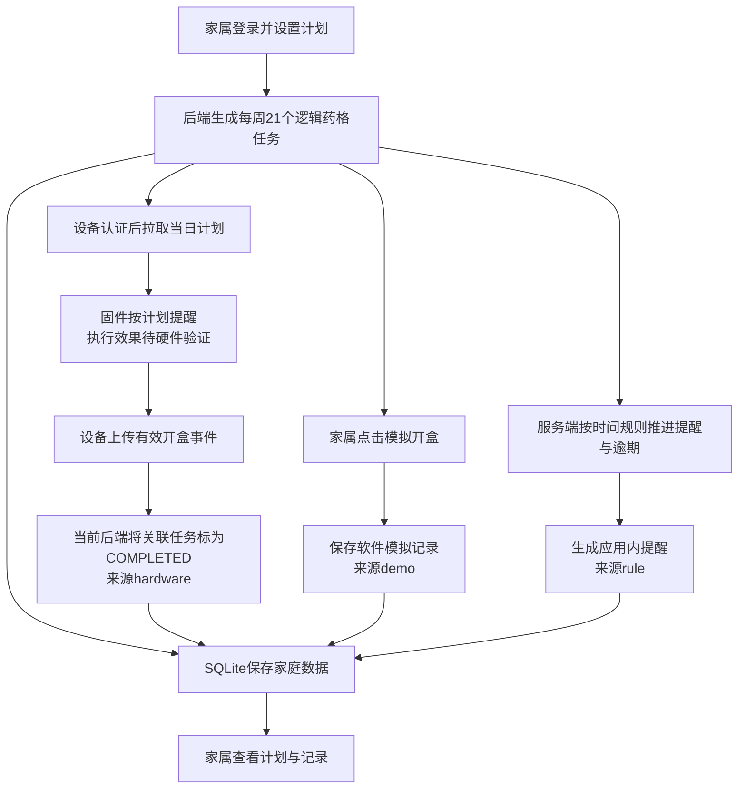
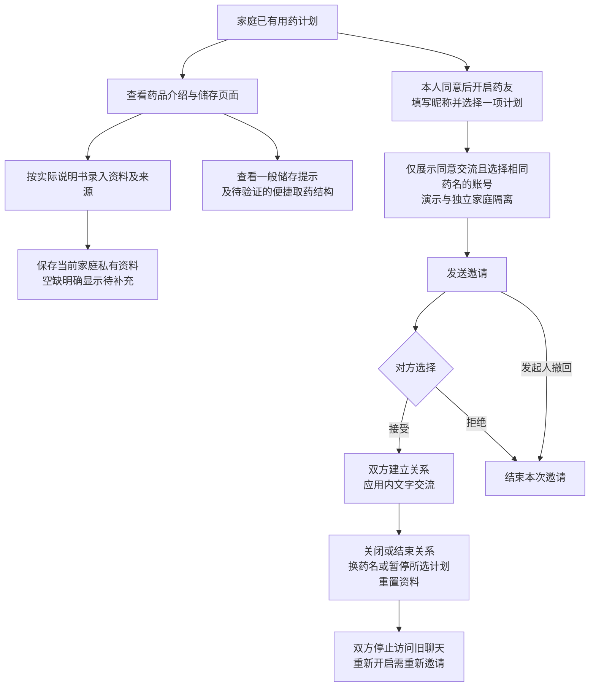
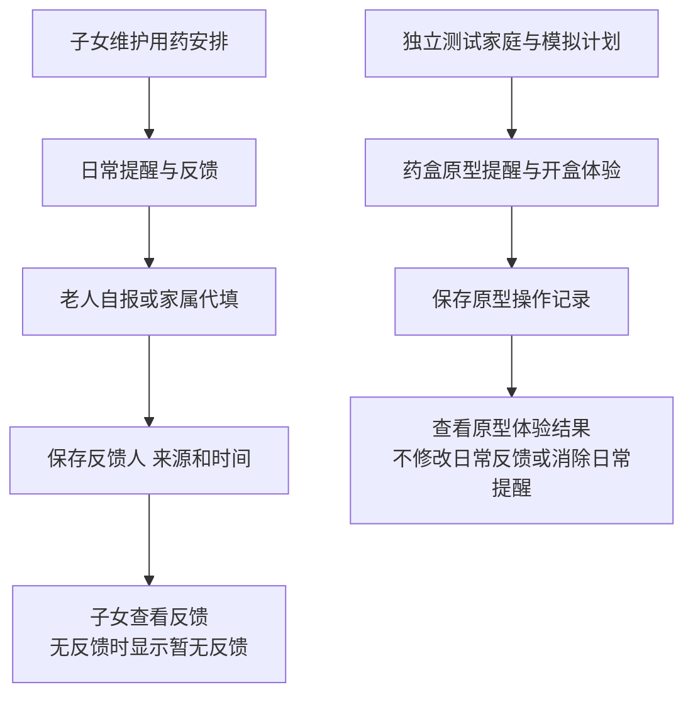
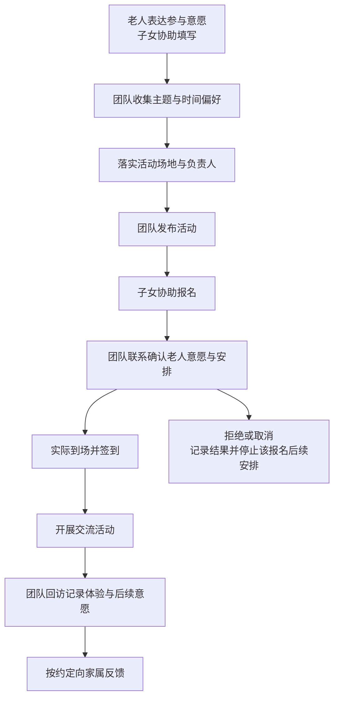

# 系统流程与实现边界

更新：2026-11-06。目标、范围和排期统一见 [PROJECT_BRIEF.md](PROJECT_BRIEF.md)。本文件只维护流程，不再保存 HTML 或图片副本。

## 1. 当前可运行的用药演示

当前技术为 FastAPI + SQLite + 原生微信小程序/浏览器预览。现有服务没有工作人员后台和活动模块，也没有硬件心跳检测。

当前提醒窗口为 30 分钟，窗口内每 10 分钟计一次提醒，最多 3 次；窗口结束 15 分钟后生成应用内家属提醒。蜂鸣器执行、微信订阅消息与短信不属于已经验证的能力。

当前原型不能真正存药。上述 COMPLETED 是现有代码的任务状态，不能理解为已经核实吞服。真实试用前应完成下一节的数据隔离。

### 新增药品资料、储存提示与同药话题交友

以下软件链路已补充到小程序、浏览器预览和后端；硬件便捷取药、密封、防潮、避光只列为待验证设计。

只按药名文字归一比较，不推断疾病或验证药物可替换。推荐不自动带出电话、住址、病史和完整药单。聊天只允许关系双方在继续参与时访问；关闭后保留本地历史但不继续提供访问。

## 2. 拟重构的用药支持流程

本节尚未实现。设备上报来源与记录用途需要分别标识，不能只凭 hardware 判定为真实日常用药。

## 3. 拟建设的线下陪伴服务

本节尚未实现。工作人员使用独立网页账号，处理职责范围内的报名、签到和回访。不从药品推断疾病，不在活动名单公开病历和联系方式；个人继续联系需双方自愿。

活动状态为草稿、开放报名、报名截止、已完成或已取消。报名状态为待联系、已确认、已签到、已回访，另设已取消和未到场；报名与实际参加分别统计。
