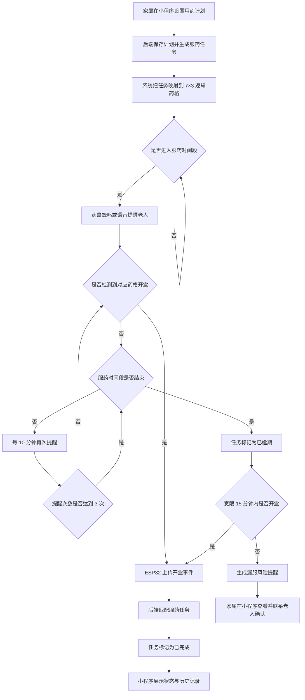
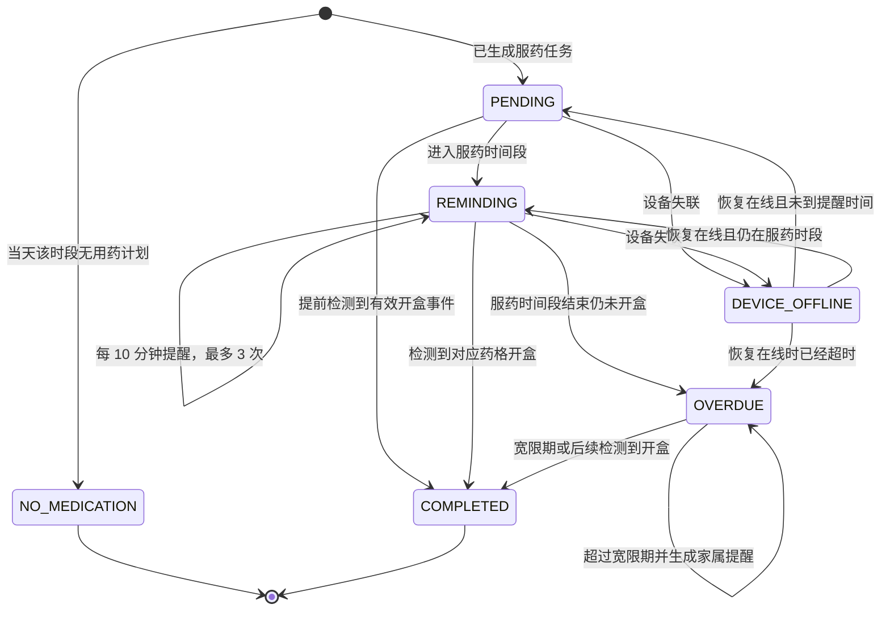
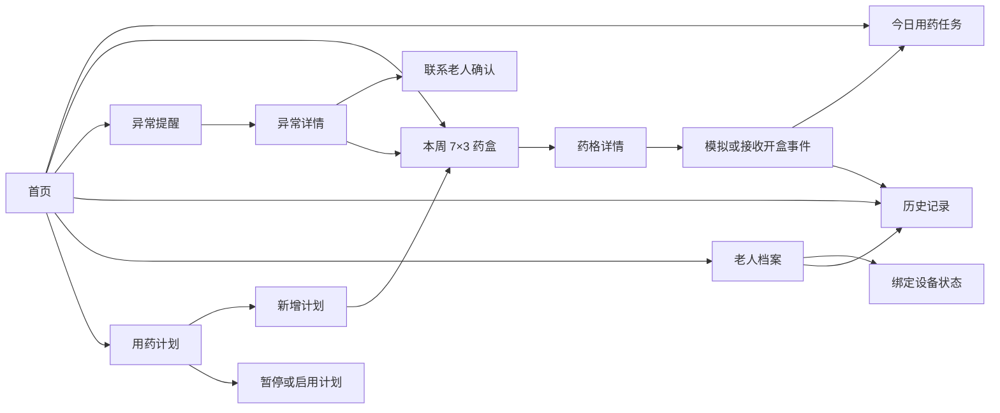

# 独居老人智能用药管理系统：流程图设计

> 版本：v0.1  
> 日期：2026-09-23  
> 范围：家属端微信小程序、智能药盒、FastAPI 后端和 MySQL 数据库  
> 说明：流程中的“已完成”表示检测到对应药格的开盒事件，不代表医学意义上的确认服药。

## 1. 核心业务闭环



## 2. 服药任务状态流转



## 3. 系统角色与数据交互

```mermaid
sequenceDiagram
    actor Family as 家属
    participant Mini as 微信小程序
    participant API as FastAPI 后端
    participant DB as MySQL
    participant Box as ESP32 智能药盒

    Family->>Mini: 新建或修改用药计划
    Mini->>API: 提交计划数据
    API->>DB: 保存计划并生成任务
    DB-->>API: 返回计划与任务
    API-->>Mini: 返回保存结果

    API->>Box: 同步提醒时间与药格信息
    Box-->>API: 设备在线心跳
    Box->>Family: 到时蜂鸣或语音提醒老人
    Family->>Box: 老人打开对应药格
    Box->>API: 上传设备编号、药格和开盒时间
    API->>DB: 保存事件并匹配任务
    API-->>Mini: 返回最新任务状态

    alt 规定时间内未开盒
        API->>DB: 将任务更新为已逾期
        API->>DB: 生成异常通知
        Mini->>API: 查询未读通知
        API-->>Mini: 返回漏服风险提醒
        Mini-->>Family: 展示异常并建议联系老人
    end
```

## 4. 家属端微信小程序页面流



## 5. Demo 演示流程


## 6. 当前 Demo 与正式系统的边界

- 当前 Demo 使用本地模拟数据，不连接 FastAPI、MySQL、ESP32 或微信订阅消息。
- 当前 Demo 重点验证页面结构、操作路径和异常场景是否易于理解。
- 后续正式开发时，将把模拟开盒按钮替换为设备事件接口。
- 正式小程序登录、体验版上传、订阅消息和合法域名配置需要正式 AppID。
- 项目不提供医学诊断、自动开药或药物相互作用判断。
